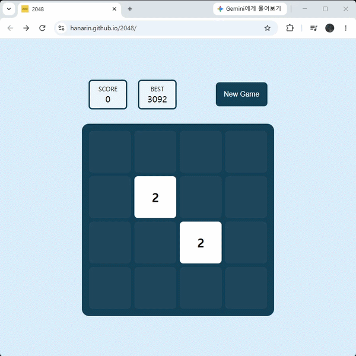

# 2048

React + TypeScript로 구현한 2048 게임 · **[플레이하기](https://hanarin.github.io/2048/)**



## 실행

npm install  
npm run dev # 개발 서버  
npm run test # 단위 테스트

## 기술 스택

React · TypeScript · Vite · CSS Modules · Vitest · GitHub Actions

## 기능

- 키보드 방향키로 블록 이동 및 병합
- 블록 생성·이동·병합 애니메이션
- 점수 및 최고 기록 (최고 기록은 게임을 다시 시작해도 유지)
- 페이지를 벗어났다 돌아와도 진행 중이던 판이 복원됨
- 더 이상 이동 및 병합할 수 없으면 게임 종료 및 재시작

## 구현하며 고민한 것

### 4방향 이동을 하나의 연산으로 정규화

상·하·좌·우 이동은 회전과 반전만 다를 뿐 규칙이 같습니다.
처음에는 방향별로 로직을 나누어 작성했는데, 같은 병합 규칙이 네 블록으로 흩어지면서 규칙을 고칠 때마다 네 곳을 수정해야 했습니다.

핵심 로직은 왼쪽 이동 한 가지만 구현하고, 좌표계를 회전·반전하는 변환 쌍을 방향별로 정의해 왼쪽 이동으로 변환 후 로직을 적용하고 다시 원상태로 변환하도록 정규화했습니다.

```ts
case "ArrowUp":
  return {
    pre:  (b) => ({ ...b, row: SIZE - 1 - b.col, col: b.row }),  // 반시계 회전
    post: (b) => ({ ...b, row: b.col, col: SIZE - 1 - b.row }),  // 시계 회전
  };
```

### 애니메이션 요구사항에 맞춰 자료구조 변경

초기에는 보드를 4×4 2차원 배열로 관리했습니다.
그런데 블록 이동에 애니메이션을 붙이려 하자, 2차원 배열은 어느 칸에 무엇이 있는가만 표현할 수 있을 뿐 이 블록이 어디에서 어디로 이동했는가를 표현할 수 없다는 것을 확인했습니다.

자료구조를 각 블록에 고유 `id`를 부여한 객체의 배열로 변경하고 이동·병합·게임오버 판정을 모두 새 형태에 맞게 다시 작성했습니다.
상태 전이가 복잡해져 `useState`에서 `useReducer`로도 함께 옮겼습니다.

이 전환 이후 구현한 애니메이션입니다.

- 위치를 CSS 커스텀 프로퍼티로 전달하고 이동 애니메이션은 transition에 위임 — JS가 매 프레임 좌표를 계산하지 않음
- 병합 시 흡수된 블록을 즉시 제거하지 않고 흡수한 블록의 좌표로 이동시킨 뒤 제거해, 두 블록이 겹쳐지는 애니메이션을 구현
- 애니메이션 진행 중 다음 입력이 들어오면 대기 중인 타이머를 취소하고 정리를 먼저 반영해, 잔상 블록이 남는 문제를 해결

요구사항이 자료구조를 결정한다는 것을 체감했습니다. 애니메이션은 UI 문제로만 보였지만 실제로는 데이터 모델링 문제이기도 했습니다.

### 테스트 코드 작성 및 타입스크립트 마이그레이션

병합 규칙과 관련해 세 차례 버그를 고치면서(같은 값 3개 연속 시 병합 대상 오류, 이동 방향 오류, 게임오버 오판정) 엣지 케이스를 눈으로 확인하는 방식의 한계를 느꼈습니다.

이동·병합·게임오버 판정이 부수효과 없는 순수 함수로 분리돼 있어 Vitest로 단위 테스트를 작성했습니다.
과거에 버그가 났던 케이스를 그대로 테스트로 고정했고, `Math.random`을 모킹해 블록 생성처럼 무작위성이 있는 함수도 결정적으로 검증했습니다.

이후 TypeScript로 마이그레이션하면서 컴파일러가 잠재 버그 세 건을 드러냈습니다.
그중 하나는 localStorage에서 복원한 블록에 애니메이션 플래그가 누락된 채 사용되던 문제로, `undefined`가 falsy라 우연히 동작하고 있었습니다.

## 개발 환경

GitHub Actions로 lint → 타입 체크 → 테스트 → 빌드 → GitHub Pages 배포로 이어지는 워크플로를 구성했습니다.
검사 비용이 낮은 단계를 앞에 배치해 실패 시 피드백이 빨리 오도록 했고, 테스트나 타입 체크가 실패하면 배포가 진행되지 않습니다.
